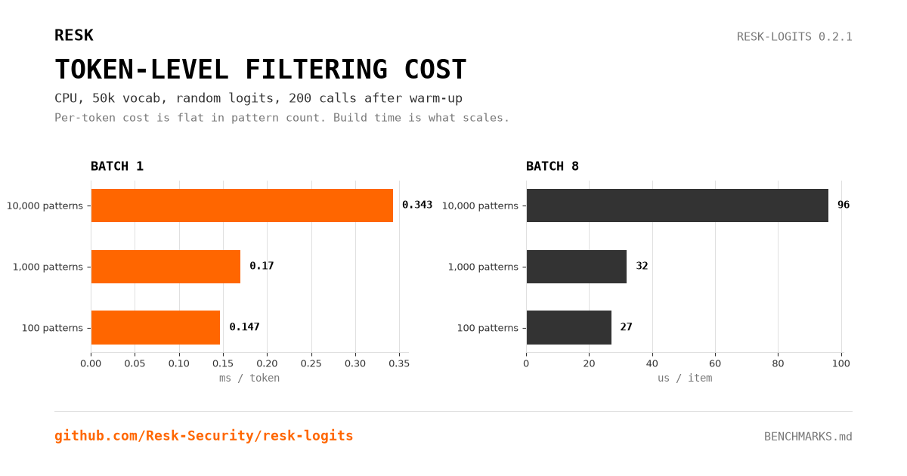

# Benchmarks

Reproducible overhead of the shadow-ban logits processor. These numbers answer
one question only: **how much time does the processor add to each decoding
step?** They say nothing about detection quality or false positives.

## Method

- Synthetic deterministic tokenizer, vocabulary padded to 50,257 tokens.
- Random logits, sequence length 32, batch 1 and 8.
- 200 timed calls per configuration after warm-up; mean and p95 reported.
- CPU only in this run (`device=cpu`), PyTorch 2.12.1, Python 3.14.8.
- Machine: Linux 7.2.11, x86_64. No GPU numbers are claimed here.

```bash
python3 benchmarks/benchmark_processor.py \
  --patterns 100,1000,10000 --batches 1,8 --iterations 200
```

Raw output: [`benchmarks/results.json`](benchmarks/results.json).

## Results (CPU, 2026-10-24)



| Patterns | Build | Danger mask | Batch | Mean / step | p95 | Per item |
|---:|---:|---:|---:|---:|---:|---:|
| 100 | 0.4 ms | 201 tokens | 1 | 0.147 ms | 0.165 ms | 147 µs |
| 100 | 0.4 ms | 201 tokens | 8 | 0.218 ms | 0.284 ms | 27 µs |
| 1,000 | 4.3 ms | 2,001 tokens | 1 | 0.170 ms | 0.207 ms | 170 µs |
| 1,000 | 4.3 ms | 2,001 tokens | 8 | 0.255 ms | 0.353 ms | 32 µs |
| 10,000 | 40.8 ms | 20,001 tokens | 1 | 0.343 ms | 0.429 ms | 343 µs |
| 10,000 | 40.8 ms | 20,001 tokens | 8 | 0.764 ms | 1.024 ms | 96 µs |

## How to read it

- The processor is O(1) per token with respect to pattern count at inference
  time: the automaton and danger mask are built once. Build time is the cost
  that scales, not the per-token path.
- At 10,000 patterns and batch 1, the added cost is about **0.34 ms per
  token** on this CPU. If a model step takes 30 ms, that is roughly 1 percent.
  Measure your own step time before quoting a percentage.
- Batching amortizes the Python and tensor overhead: at batch 8 the per-item
  cost is 27 to 96 µs depending on pattern count.
- GPU moves the mask operation to the device, but this repository does not
  publish a GPU number it has not reproduced. Run the same script on your GPU
  and keep the JSON next to the claim.

## What is not measured

- Detection recall, false positives, or bypass resistance.
- Tokenizer cost of the model itself.
- End-to-end latency including network, sampling and framework overhead.

Older changelog entries mentioned a vendor measurement of about 0.001 ms per
token on GPU. That number is not reproduced here and should not be quoted
without a run on the target hardware.
